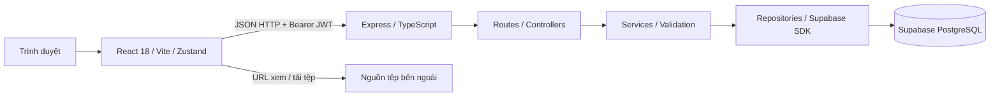

# Kiến trúc hệ thống MXH_HSSV

Ngày đối chiếu: 17/11/2026. Cơ sở: mã nguồn tại `9a7e33b`. Tài liệu mô tả triển khai trong repo; không xác nhận cấu hình hay trạng thái database đang chạy trên cloud.

## 1. Phạm vi và nguồn chuẩn

- [Đặc tả MVP](mvp-specification.md): mục tiêu sản phẩm và quy tắc mong muốn.
- [API](api-specification.md): hợp đồng HTTP hiện có và các sai khác cần sửa.
- [Dữ liệu](database-erd.md): SQL, quan hệ, từ điển bảng và các điểm không đồng bộ.
- [Triển khai](deployment-guide.md): cách dựng môi trường và điều kiện phát hành.
- [Báo cáo tính năng](feature-audit.md): phạm vi thực tế, ưu tiên và đề xuất để chủ dự án quyết định.

Khi tài liệu MVP và code khác nhau, không suy ra tính năng đã hoàn thành. Phần “hiện trạng” dựa vào code; phần “yêu cầu nghiệm thu” là công việc còn phải thực hiện.

## 2. Các thành phần đang có

Frontend chạy như SPA, điều hướng bằng React Router. `frontend/src/services/api.client.ts` thêm access token từ localStorage và trả về `payload.data`; không tự refresh token khi nhận 401, đồng thời không chuyển tiếp `meta` cho caller. Zustand quản lý auth và trạng thái giao diện. Route frontend yêu cầu đăng nhập cho phần lớn màn hình, kể cả một số API đọc công khai.

Backend khởi động ở `backend/src/server.ts`, mount tám router tại `backend/src/app.ts`. Express nhận JSON tối đa 10 MB và CORS cho một origin cấu hình. Controller đọc request, validator kiểm tra đầu vào, service xử lý nghiệp vụ. Một số service gọi Supabase trực tiếp, vì vậy cấu trúc repository chưa được áp dụng tuyệt đối.

Runtime truy cập dữ liệu bằng `@supabase/supabase-js`, không qua Prisma Client. Schema Prisma mới phản ánh phần nền tảng/định danh, không đại diện toàn hệ thống. Các file SQL trong `database/schema` là mô hình dữ liệu có thể kiểm tra trong repo, chưa có chuỗi migration nâng cấp được quản lý đầy đủ.

## 3. Ranh giới tám module

| Module | Trách nhiệm | Liên kết chính |
| --- | --- | --- |
| Identity | Tài khoản, OTP, hồ sơ, biệt danh, danh mục khoa/môn | Cấp JWT cho các module |
| Feed | Bảng tin ba phạm vi, câu hỏi, bình luận, vote, đáp án | Identity; Karma; Notifications |
| Study group | Tuyển thành viên, xét đơn, workspace, task, tài liệu | Courses; Group chat; Karma |
| Course review | Review môn/giảng viên, tổng hợp, tìm câu hỏi | Courses; Feed |
| Resource hub | Metadata tài liệu, phân loại, vote, ghi nhận tải | Courses; Karma/quota |
| Marketplace | Tin đồ cũ/tặng đồ và nhà trọ/ở ghép | Identity; Karma |
| Communication | Hội thoại, tin nhắn, thông báo và trạng thái đọc | Thành viên nhóm; sự kiện nghiệp vụ |
| Moderation | Báo cáo, tạm ẩn, xử lý, điểm và đặc quyền | Nội dung các module |

## 4. Luồng chính và nhất quán dữ liệu

1. Đăng ký: kiểm tra domain → tạo user/hồ sơ → lưu hash OTP với hạn dùng → trả metadata. Môi trường ngoài production trả thêm `devOtpPreview`. Chưa có dịch vụ gửi email.
2. Xác thực OTP: kiểm tra hạn dùng/số lần thử → cập nhật verified → phát access/refresh JWT. Các thao tác ghi có middleware verified ở Feed, Review, Resource; không được giả định mọi router đều có middleware này.
3. Tuyển nhóm: tạo nhóm/vị trí → ứng tuyển → trưởng nhóm duyệt → thêm thành viên, cập nhật tuyển dụng và thêm vào hội thoại nhóm. Đây là chuỗi lệnh SDK, chưa có bằng chứng giao dịch nguyên tử xuyên toàn bộ luồng.
4. Đáp án/vote/task/tặng đồ gọi dịch vụ Karma và/hoặc thông báo. Ledger và tổng điểm cập nhật bằng nhiều truy vấn; có nguy cơ lệch điểm khi lỗi giữa chừng hoặc ghi đồng thời.
5. Chat và thông báo lưu trong DB, đọc/ghi qua REST. Tên service có chữ “realtime” không đồng nghĩa đã có push realtime.

Yêu cầu nghiệm thu: duyệt đơn khi còn đúng một chỗ chỉ nhận đủ số lượng; một sự kiện chỉ thưởng một lần; lỗi thông báo không được làm mất nghiệp vụ chính; tác vụ bù có thể đối soát ledger với tổng điểm. Các yêu cầu này cần kiểm thử tích hợp trước khi xác nhận đạt.

## 5. Xác thực và quyền truy cập

JWT riêng của backend chứa danh tính, role và trạng thái verified. Backend chọn Supabase key theo thứ tự service-role → publishable → anon. Service-role có thể vượt RLS; do đó backend phải kiểm tra quyền đối với từng tài nguyên. JWT riêng không tự tạo `auth.uid()` hợp lệ cho policy Supabase Auth.

Admin/moderator được kiểm tra tại một số controller quản trị. `GET /moderation/admin/settings` hiện chỉ yêu cầu đăng nhập; tên đường dẫn không bảo đảm có kiểm tra role. Auth middleware chỉ xác minh token, chưa tra lại trạng thái khóa user trên mỗi request. Khóa tài khoản cần đi kèm cơ chế vô hiệu hóa phiên/token để có hiệu lực ngay.

Ẩn danh là ẩn danh với người dùng khác, không phải với hệ thống. Author ID thật phải được lưu để kiểm duyệt, nhưng không được lộ qua payload công khai, lỗi, log trình duyệt hay dữ liệu lồng nhau. Cần kiểm thử riêng cho bài viết, bình luận và review.

## 6. Những thành phần chưa triển khai

Các file cấu hình mail, OAuth, Redis, socket, storage/search cùng các job và gateway hiện có nhiều file rỗng. Chưa có Socket.IO, hàng đợi Redis, cron nhắc deadline, pipeline lưu trữ/quét tệp, KaTeX hoặc thư viện syntax highlighting trong dependency hiện tại. `LatexMathRenderer` hiển thị biểu thức dạng code; `CodeSnippetBlock` hiển thị và copy văn bản.

`docker-compose.yml` và hai Dockerfile rỗng. Không có bằng chứng CI/CD hoặc monitoring production trong repo. Không coi tên file/ghi chú “Complete MVP” ở health endpoint là bằng chứng hệ thống đã sẵn sàng phát hành.

## 7. Yêu cầu trước khi dùng thật

- Chặn hoặc thay callback SSO nhận danh tính tự khai bằng xác minh provider, authorization code, state/nonce và token hợp lệ.
- Tích hợp email OTP; giới hạn request đăng nhập/đăng ký/OTP theo tài khoản và nguồn truy cập.
- Đồng bộ schema với truy vấn, bổ sung ledger và quy trình migration có rollback.
- Dùng kiểm tra quyền server cho thành viên nhóm, chủ tin, người tham gia chat và admin; kiểm tra trạng thái khóa hiện thời.
- Chuẩn hóa lỗi công khai, không trả thông báo database nội bộ; ghi log có mã request và loại bỏ bí mật.
- Chọn một phương án realtime nếu thật sự cần; REST và nút tải lại đủ cho bản đầu nếu được mô tả đúng.
- Dùng storage riêng tư và URL có hạn nếu muốn kiểm soát quyền tải; URL công khai không thực thi được quota.
- Bổ sung backup/restore, giám sát lỗi và kiểm thử liên thông bằng tài khoản thật ở staging.

Không đặt SLA hay tuyên bố hỗ trợ một lượng người dùng cụ thể trước khi đo tải. MVP nên ưu tiên đúng dữ liệu, quyền truy cập và luồng học tập thiết yếu.
