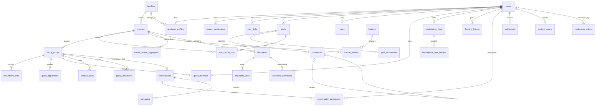

# Đặc tả dữ liệu và ERD MXH_HSSV

Đối chiếu ngày 17/11/2026 với source `9a7e33b`. Nguồn mô hình hiện có là tám file `database/schema/*.sql`; không phải bản xuất từ database cloud. Phần Prisma chỉ phản ánh một phần hệ thống, không dùng để suy ra toàn bộ schema.

## 1. Quy ước

PostgreSQL, schema `public`, ID chủ yếu UUID do `gen_random_uuid()` tạo. Timestamp dùng TIMESTAMPTZ; giá VND dùng số nguyên; semester dạng chuỗi. Các ENUM được khai báo trong SQL từng module. SQL đầu tiên cài extension và hàm dùng chung; chạy theo thứ tự 01 → 08.

Khóa ngoại nullable và ON DELETE SET NULL được dùng khi muốn giữ record sau khi mất liên kết tùy chọn; CASCADE có thể xóa dữ liệu phụ thuộc. Không thực hiện xóa user thực tế trước khi chốt chính sách lưu nhật ký và nội dung học tập. Target đa hình (`target_type,target_id`) không tự có FK tới mọi bảng: service phải kiểm tra loại và sự tồn tại.

## 2. Nhóm dữ liệu

| Miền | Bảng | Vai trò / ràng buộc chính |
| --- | --- | --- |
| Danh mục | faculties, courses | Mã khoa/môn unique; môn thuộc khoa |
| Định danh | users | Email unique, password hash, role, verified, trạng thái, tổng Karma |
| Định danh | academic_profiles | user_id vừa PK vừa FK; MSSV và biệt danh unique; tên/avatar nằm ở đây |
| Định danh | student_verifications, user_skills | OTP hash/TTL/lần thử; kỹ năng unique theo user/tên/loại |
| Đặc quyền | privilege_tiers | tier_code và min_karma unique; cấu hình tier trong DB cần đối chiếu hằng số code |
| Feed | posts, comments | Phạm vi bài, ẩn danh, trạng thái; comment có parent tự tham chiếu |
| Feed | post_attachments, post_course_tags, votes | Metadata tệp; liên kết môn; vote unique theo user/loại/target |
| Nhóm | study_groups, recruitment_slots | Nhóm thuộc môn, trưởng nhóm; vị trí/số lượng tuyển |
| Nhóm | group_applications, group_members | Đơn unique theo nhóm/applicant; thành viên PK ghép nhóm/user |
| Nhóm | kanban_tasks, group_documents | Task/trạng thái/deadline; metadata tệp có uploader và tên file |
| Review | lecturers, course_reviews, course_review_aggregates | Review theo môn/giảng viên/tác giả/kỳ; aggregate theo môn/giảng viên |
| Tài liệu | documents, document_votes, document_downloads | Phân loại theo khoa/môn/kỳ; metadata, đánh giá và lịch sử tải |
| Chợ | marketplace_items, marketplace_item_images | Chủ tin, giá/trạng thái/ảnh theo thứ tự |
| Nhà ở | housing_listings | Khu vực, ngân sách, khoảng cách/thói quen tự khai |
| Chat | conversations, conversation_participants, messages | Hội thoại, quyền thành viên, nội dung tin; unique direct_pair_key |
| Thông báo | notifications | Người nhận, actor tùy chọn, nội dung, đã đọc, tham chiếu đối tượng |
| Kiểm duyệt | content_reports, moderation_actions, auto_mod_settings | Báo cáo unique reporter/target; nhật ký; ngưỡng theo reason |

Số bảng chính xác và danh sách cột trong SQL được thống kê tại phụ lục. `karma_ledger` được service sử dụng nhưng chưa có CREATE TABLE trong repo, nên không tính như một bảng đã có schema.

## 3. ERD các quan hệ trọng tâm

Sơ đồ lược bỏ một số FK tác giả để dễ đọc; định nghĩa SQL trong phụ lục là nguồn chính xác cho nullability, khóa và hành vi xóa. Quan hệ profile là user có tối đa một profile ở tầng FK; luồng đăng ký có trách nhiệm tạo profile.



## 4. Ràng buộc và index cần bảo toàn

- PK ghép ở group_members/conversation_participants ngăn thành viên trùng; unique direct_pair_key ngăn hai hội thoại trực tiếp cho cùng cặp khi key được chuẩn hóa.
- Review/aggregate dùng `UNIQUE NULLS NOT DISTINCT`, giúp lecturer_id NULL không tạo bản trùng không mong muốn. Cần PostgreSQL hỗ trợ cú pháp này; không áp dụng nguyên xi lên bản cũ không tương thích.
- CHECK cho điểm review 1–5, số lượng thành viên, giá/kích thước không âm có trong SQL; không thay thế validation đầu vào API.
- Post có search_vector generated và GIN index; danh mục môn có trigram index. Không gọi đây là tìm kiếm tiếng Việt chất lượng cao trước khi kiểm chứng cấu hình tokenizer và tập truy vấn thực tế.
- Index theo khóa ngoại, created_at và bộ lọc phổ biến được đặt trong SQL. Cần dùng EXPLAIN/đo tải trên dữ liệu đại diện trước khi bổ sung hoặc xóa index.
- RLS được khai báo trong SQL. Không có kết quả kiểm toán cloud để xác nhận “0 cảnh báo” hoặc policy đã được áp dụng đầy đủ. Khi backend dùng service-role, phải kiểm soát quyền ở API.

## 5. Chênh lệch code–schema phải sửa trước nghiệm thu

| Khu vực | Code đang dùng | SQL trong repo | Hệ quả |
| --- | --- | --- | --- |
| courseId nhóm/chợ | number / Number(...) | courses.id UUID | Payload/filter không tương thích |
| Hồ sơ lồng nhóm/chợ/chat/thông báo | users.full_name, users.avatar_url | academic_profiles.full_name/avatar_url | Projection có thể lỗi cột không tồn tại |
| Hồ sơ nhà ở | academic_profiles.student_id | student_code | Sai tên cột |
| study_groups | group_name, project_topic | name, description | Insert/read không thống nhất |
| group_applications | cover_letter | cover_note | Insert không thống nhất |
| group_members | assigned_role | assigned_position | Thêm thành viên không thống nhất |
| group_documents | uploaded_by, file_size_bytes; thiếu file_name | uploader_id, file_size, file_name NOT NULL | Lưu metadata/FK projection không thống nhất |
| housing_listings | address_district | address_area | Tạo/lọc tin có thể lỗi |
| messages | file_url, file_name, file_size_bytes | attachment_url, attachment_name; không có file_size_bytes | Gửi tin có trường không tồn tại |
| notifications | reference_url | reference_type, reference_id | Tạo thông báo có trường không tồn tại |
| Karma | karma_ledger | Chưa có DDL | Lịch sử/thưởng điểm không thể dựng đầy đủ từ repo |

Đây là đối chiếu tĩnh; database cloud có thể đã được chỉnh thủ công. Nếu cloud khác repo, phải xuất migration để tái lập, thay vì xem cấu hình ngoài repo là bảo đảm ngầm. Danh sách trên tập trung các lỗi đã thấy, không thay cho chạy toàn bộ truy vấn trên schema mới.

## 6. Thiết kế cần bổ sung (chưa triển khai)

Nếu giữ Karma, bổ sung migration `karma_ledger` gồm ID, user_id FK, action_type, points_delta, reference_type/reference_id, created_at; quyết định uniqueness theo sự kiện/người tác động, chống tự thưởng và ghi tổng điểm trong cùng giao dịch. Code hiện bỏ qua mọi lỗi insert ledger, không chỉ lỗi duplicate, nên có thể che mất bảng/lỗi quyền. Không tự tạo DDL dựa trên giả định thưởng điểm trước khi chốt luật sản phẩm.

Các aggregate/counter là dữ liệu dẫn xuất, cần cơ chế tái tính và kiểm thử concurrency. Chọn một schema chuẩn rồi sửa DTO, query và UI theo schema đó. Migration phải có backfill và kiểm tra trước/sau, không rename cột production tùy tiện.

Quyền riêng tư: không trả password_hash/otp_hash; hạn chế hiển thị MSSV/email cho người không cần; author_id thật của nội dung ẩn danh chỉ dành cho xử lý được phân quyền. Cần chính sách thời hạn lưu OTP, log, tin nhắn và dữ liệu user trước phát hành.

## 7. Phụ lục từ điển bảng theo SQL

Các block dưới đây trích nguyên định nghĩa CREATE TABLE từ source để giữ chính xác kiểu dữ liệu, default, NULL, CHECK và khóa. Không bao gồm toàn bộ enum, index, trigger hay policy; mở file nguồn tương ứng khi dựng DB. Phụ lục là snapshot, phải cập nhật cùng thay đổi schema.

Tổng số bảng có DDL: **34**.

### faculties

Nguồn: [01_identity_verification.sql](../database/schema/01_identity_verification.sql).

```sql
CREATE TABLE IF NOT EXISTS public.faculties (
    id UUID PRIMARY KEY DEFAULT gen_random_uuid(),
    code VARCHAR(20) NOT NULL UNIQUE,
    name VARCHAR(150) NOT NULL,
    description TEXT,
    created_at TIMESTAMPTZ NOT NULL DEFAULT NOW(),
    updated_at TIMESTAMPTZ NOT NULL DEFAULT NOW()
);
```

### courses

Nguồn: [01_identity_verification.sql](../database/schema/01_identity_verification.sql).

```sql
CREATE TABLE IF NOT EXISTS public.courses (
    id UUID PRIMARY KEY DEFAULT gen_random_uuid(),
    code VARCHAR(20) NOT NULL UNIQUE,
    name VARCHAR(200) NOT NULL,
    faculty_id UUID NOT NULL REFERENCES public.faculties(id) ON DELETE RESTRICT,
    credits SMALLINT NOT NULL DEFAULT 3 CHECK (credits >= 0 AND credits <= 15),
    description TEXT,
    created_at TIMESTAMPTZ NOT NULL DEFAULT NOW(),
    updated_at TIMESTAMPTZ NOT NULL DEFAULT NOW()
);
```

### privilege_tiers

Nguồn: [01_identity_verification.sql](../database/schema/01_identity_verification.sql).

```sql
CREATE TABLE IF NOT EXISTS public.privilege_tiers (
    id UUID PRIMARY KEY DEFAULT gen_random_uuid(),
    tier_code VARCHAR(40) NOT NULL UNIQUE,
    min_karma INTEGER NOT NULL UNIQUE,
    daily_download_limit INTEGER, -- NULL means unlimited downloads
    can_create_custom_group BOOLEAN NOT NULL DEFAULT FALSE,
    badge_label VARCHAR(80) NOT NULL,
    created_at TIMESTAMPTZ NOT NULL DEFAULT NOW()
);
```

### users

Nguồn: [01_identity_verification.sql](../database/schema/01_identity_verification.sql).

```sql
CREATE TABLE IF NOT EXISTS public.users (
    id UUID PRIMARY KEY DEFAULT gen_random_uuid(),
    email VARCHAR(255) NOT NULL UNIQUE,
    password_hash TEXT,
    role public.user_role NOT NULL DEFAULT 'UNVERIFIED_USER',
    is_verified_student BOOLEAN NOT NULL DEFAULT FALSE,
    verified_at TIMESTAMPTZ,
    karma_points INTEGER NOT NULL DEFAULT 0,
    status public.user_status NOT NULL DEFAULT 'ACTIVE',
    last_login_at TIMESTAMPTZ,
    created_at TIMESTAMPTZ NOT NULL DEFAULT NOW(),
    updated_at TIMESTAMPTZ NOT NULL DEFAULT NOW()
);
```

### student_verifications

Nguồn: [01_identity_verification.sql](../database/schema/01_identity_verification.sql).

```sql
CREATE TABLE IF NOT EXISTS public.student_verifications (
    id UUID PRIMARY KEY DEFAULT gen_random_uuid(),
    user_id UUID NOT NULL REFERENCES public.users(id) ON DELETE CASCADE,
    edu_email VARCHAR(255) NOT NULL,
    otp_hash TEXT,
    provider public.verification_provider NOT NULL DEFAULT 'EDU_OTP',
    sso_subject_id VARCHAR(255),
    expires_at TIMESTAMPTZ NOT NULL,
    attempts SMALLINT NOT NULL DEFAULT 0 CHECK (attempts >= 0),
    max_attempts SMALLINT NOT NULL DEFAULT 5 CHECK (max_attempts > 0),
    last_sent_at TIMESTAMPTZ NOT NULL DEFAULT NOW(),
    verified_at TIMESTAMPTZ,
    created_at TIMESTAMPTZ NOT NULL DEFAULT NOW()
);
```

### academic_profiles

Nguồn: [01_identity_verification.sql](../database/schema/01_identity_verification.sql).

```sql
CREATE TABLE IF NOT EXISTS public.academic_profiles (
    user_id UUID PRIMARY KEY REFERENCES public.users(id) ON DELETE CASCADE,
    student_code VARCHAR(30) UNIQUE,
    full_name VARCHAR(120) NOT NULL,
    avatar_url TEXT,
    faculty_id UUID REFERENCES public.faculties(id) ON DELETE SET NULL,
    major VARCHAR(150),
    cohort VARCHAR(30),
    class_name VARCHAR(80),
    career_goal TEXT,
    bio TEXT,
    anonymous_handle VARCHAR(60) NOT NULL UNIQUE,
    anonymous_avatar TEXT,
    anonymous_last_changed_at TIMESTAMPTZ,
    created_at TIMESTAMPTZ NOT NULL DEFAULT NOW(),
    updated_at TIMESTAMPTZ NOT NULL DEFAULT NOW()
);
```

### user_skills

Nguồn: [01_identity_verification.sql](../database/schema/01_identity_verification.sql).

```sql
CREATE TABLE IF NOT EXISTS public.user_skills (
    id UUID PRIMARY KEY DEFAULT gen_random_uuid(),
    user_id UUID NOT NULL REFERENCES public.users(id) ON DELETE CASCADE,
    skill_name VARCHAR(100) NOT NULL,
    category public.skill_category NOT NULL DEFAULT 'TECHNICAL',
    proficiency_level public.skill_proficiency NOT NULL DEFAULT 'INTERMEDIATE',
    created_at TIMESTAMPTZ NOT NULL DEFAULT NOW(),
    CONSTRAINT uq_user_skill UNIQUE (user_id, skill_name, category)
);
```

### posts

Nguồn: [02_academic_feed_discussion.sql](../database/schema/02_academic_feed_discussion.sql).

```sql
CREATE TABLE IF NOT EXISTS public.posts (
    id UUID PRIMARY KEY DEFAULT gen_random_uuid(),
    author_id UUID NOT NULL REFERENCES public.users(id) ON DELETE CASCADE,
    feed_scope public.feed_scope NOT NULL DEFAULT 'CAMPUS',
    faculty_id UUID REFERENCES public.faculties(id) ON DELETE SET NULL,
    course_id UUID REFERENCES public.courses(id) ON DELETE SET NULL,
    post_type public.post_type NOT NULL DEFAULT 'DISCUSSION',
    title VARCHAR(255) NOT NULL,
    content_body TEXT NOT NULL,
    has_latex BOOLEAN NOT NULL DEFAULT FALSE,
    has_code BOOLEAN NOT NULL DEFAULT FALSE,
    is_anonymous BOOLEAN NOT NULL DEFAULT FALSE,
    upvote_count INTEGER NOT NULL DEFAULT 0,
    downvote_count INTEGER NOT NULL DEFAULT 0,
    helpful_count INTEGER NOT NULL DEFAULT 0,
    comment_count INTEGER NOT NULL DEFAULT 0,
    accepted_comment_id UUID,
    status public.content_status NOT NULL DEFAULT 'PUBLISHED',
    search_vector TSVECTOR GENERATED ALWAYS AS (
        to_tsvector('simple', coalesce(title, '') || ' ' || coalesce(content_body, ''))
    ) STORED,
    created_at TIMESTAMPTZ NOT NULL DEFAULT NOW(),
    updated_at TIMESTAMPTZ NOT NULL DEFAULT NOW()
);
```

### post_attachments

Nguồn: [02_academic_feed_discussion.sql](../database/schema/02_academic_feed_discussion.sql).

```sql
CREATE TABLE IF NOT EXISTS public.post_attachments (
    id UUID PRIMARY KEY DEFAULT gen_random_uuid(),
    post_id UUID NOT NULL REFERENCES public.posts(id) ON DELETE CASCADE,
    file_url TEXT NOT NULL,
    file_name VARCHAR(255) NOT NULL,
    file_type VARCHAR(80) NOT NULL DEFAULT 'application/pdf',
    file_size INTEGER NOT NULL DEFAULT 0 CHECK (file_size >= 0),
    created_at TIMESTAMPTZ NOT NULL DEFAULT NOW()
);
```

### post_course_tags

Nguồn: [02_academic_feed_discussion.sql](../database/schema/02_academic_feed_discussion.sql).

```sql
CREATE TABLE IF NOT EXISTS public.post_course_tags (
    post_id UUID NOT NULL REFERENCES public.posts(id) ON DELETE CASCADE,
    course_id UUID NOT NULL REFERENCES public.courses(id) ON DELETE CASCADE,
    created_at TIMESTAMPTZ NOT NULL DEFAULT NOW(),
    PRIMARY KEY (post_id, course_id)
);
```

### comments

Nguồn: [02_academic_feed_discussion.sql](../database/schema/02_academic_feed_discussion.sql).

```sql
CREATE TABLE IF NOT EXISTS public.comments (
    id UUID PRIMARY KEY DEFAULT gen_random_uuid(),
    post_id UUID NOT NULL REFERENCES public.posts(id) ON DELETE CASCADE,
    author_id UUID NOT NULL REFERENCES public.users(id) ON DELETE CASCADE,
    parent_comment_id UUID REFERENCES public.comments(id) ON DELETE CASCADE,
    content_body TEXT NOT NULL,
    has_latex BOOLEAN NOT NULL DEFAULT FALSE,
    has_code BOOLEAN NOT NULL DEFAULT FALSE,
    is_anonymous BOOLEAN NOT NULL DEFAULT FALSE,
    is_accepted BOOLEAN NOT NULL DEFAULT FALSE,
    upvote_count INTEGER NOT NULL DEFAULT 0,
    downvote_count INTEGER NOT NULL DEFAULT 0,
    helpful_count INTEGER NOT NULL DEFAULT 0,
    status public.content_status NOT NULL DEFAULT 'PUBLISHED',
    created_at TIMESTAMPTZ NOT NULL DEFAULT NOW(),
    updated_at TIMESTAMPTZ NOT NULL DEFAULT NOW()
);
```

### votes

Nguồn: [02_academic_feed_discussion.sql](../database/schema/02_academic_feed_discussion.sql).

```sql
CREATE TABLE IF NOT EXISTS public.votes (
    id UUID PRIMARY KEY DEFAULT gen_random_uuid(),
    user_id UUID NOT NULL REFERENCES public.users(id) ON DELETE CASCADE,
    target_type public.vote_target_type NOT NULL,
    target_id UUID NOT NULL,
    vote_type public.vote_type NOT NULL DEFAULT 'UPVOTE',
    created_at TIMESTAMPTZ NOT NULL DEFAULT NOW(),
    CONSTRAINT uq_user_target_vote UNIQUE (user_id, target_type, target_id)
);
```

### study_groups

Nguồn: [03_study_group_matching.sql](../database/schema/03_study_group_matching.sql).

```sql
CREATE TABLE IF NOT EXISTS public.study_groups (
    id UUID PRIMARY KEY DEFAULT gen_random_uuid(),
    name VARCHAR(150) NOT NULL,
    course_id UUID NOT NULL REFERENCES public.courses(id) ON DELETE RESTRICT,
    semester VARCHAR(20) NOT NULL,
    leader_id UUID NOT NULL REFERENCES public.users(id) ON DELETE CASCADE,
    target_grade public.target_grade_goal NOT NULL DEFAULT 'A',
    max_members SMALLINT NOT NULL DEFAULT 4 CHECK (max_members BETWEEN 2 AND 15),
    description TEXT,
    is_recruiting BOOLEAN NOT NULL DEFAULT TRUE,
    created_at TIMESTAMPTZ NOT NULL DEFAULT NOW(),
    updated_at TIMESTAMPTZ NOT NULL DEFAULT NOW()
);
```

### recruitment_slots

Nguồn: [03_study_group_matching.sql](../database/schema/03_study_group_matching.sql).

```sql
CREATE TABLE IF NOT EXISTS public.recruitment_slots (
    id UUID PRIMARY KEY DEFAULT gen_random_uuid(),
    group_id UUID NOT NULL REFERENCES public.study_groups(id) ON DELETE CASCADE,
    role_name VARCHAR(80) NOT NULL,
    required_skills TEXT[] NOT NULL DEFAULT '{}',
    quantity_needed SMALLINT NOT NULL DEFAULT 1 CHECK (quantity_needed >= 1),
    quantity_filled SMALLINT NOT NULL DEFAULT 0 CHECK (quantity_filled >= 0),
    created_at TIMESTAMPTZ NOT NULL DEFAULT NOW()
);
```

### group_applications

Nguồn: [03_study_group_matching.sql](../database/schema/03_study_group_matching.sql).

```sql
CREATE TABLE IF NOT EXISTS public.group_applications (
    id UUID PRIMARY KEY DEFAULT gen_random_uuid(),
    group_id UUID NOT NULL REFERENCES public.study_groups(id) ON DELETE CASCADE,
    slot_id UUID REFERENCES public.recruitment_slots(id) ON DELETE SET NULL,
    applicant_id UUID NOT NULL REFERENCES public.users(id) ON DELETE CASCADE,
    cover_note TEXT NOT NULL,
    portfolio_url TEXT,
    status public.application_status NOT NULL DEFAULT 'PENDING',
    reviewed_at TIMESTAMPTZ,
    created_at TIMESTAMPTZ NOT NULL DEFAULT NOW(),
    CONSTRAINT uq_group_applicant UNIQUE (group_id, applicant_id)
);
```

### group_members

Nguồn: [03_study_group_matching.sql](../database/schema/03_study_group_matching.sql).

```sql
CREATE TABLE IF NOT EXISTS public.group_members (
    group_id UUID NOT NULL REFERENCES public.study_groups(id) ON DELETE CASCADE,
    user_id UUID NOT NULL REFERENCES public.users(id) ON DELETE CASCADE,
    member_role public.group_member_role NOT NULL DEFAULT 'MEMBER',
    assigned_position VARCHAR(80) NOT NULL DEFAULT 'Member',
    joined_at TIMESTAMPTZ NOT NULL DEFAULT NOW(),
    PRIMARY KEY (group_id, user_id)
);
```

### kanban_tasks

Nguồn: [03_study_group_matching.sql](../database/schema/03_study_group_matching.sql).

```sql
CREATE TABLE IF NOT EXISTS public.kanban_tasks (
    id UUID PRIMARY KEY DEFAULT gen_random_uuid(),
    group_id UUID NOT NULL REFERENCES public.study_groups(id) ON DELETE CASCADE,
    title VARCHAR(200) NOT NULL,
    description TEXT,
    status public.kanban_task_status NOT NULL DEFAULT 'TODO',
    priority public.kanban_task_priority NOT NULL DEFAULT 'MEDIUM',
    assignee_id UUID REFERENCES public.users(id) ON DELETE SET NULL,
    due_date TIMESTAMPTZ,
    position_order INTEGER NOT NULL DEFAULT 0,
    completed_at TIMESTAMPTZ,
    created_at TIMESTAMPTZ NOT NULL DEFAULT NOW(),
    updated_at TIMESTAMPTZ NOT NULL DEFAULT NOW()
);
```

### group_documents

Nguồn: [03_study_group_matching.sql](../database/schema/03_study_group_matching.sql).

```sql
CREATE TABLE IF NOT EXISTS public.group_documents (
    id UUID PRIMARY KEY DEFAULT gen_random_uuid(),
    group_id UUID NOT NULL REFERENCES public.study_groups(id) ON DELETE CASCADE,
    uploader_id UUID NOT NULL REFERENCES public.users(id) ON DELETE CASCADE,
    title VARCHAR(200) NOT NULL,
    file_url TEXT NOT NULL,
    file_name VARCHAR(255) NOT NULL,
    file_size INTEGER NOT NULL DEFAULT 0 CHECK (file_size >= 0),
    created_at TIMESTAMPTZ NOT NULL DEFAULT NOW()
);
```

### lecturers

Nguồn: [04_course_review_qa.sql](../database/schema/04_course_review_qa.sql).

```sql
CREATE TABLE IF NOT EXISTS public.lecturers (
    id UUID PRIMARY KEY DEFAULT gen_random_uuid(),
    full_name VARCHAR(150) NOT NULL,
    email VARCHAR(255) UNIQUE,
    faculty_id UUID NOT NULL REFERENCES public.faculties(id) ON DELETE RESTRICT,
    academic_title VARCHAR(80) DEFAULT 'Giảng viên',
    bio TEXT,
    created_at TIMESTAMPTZ NOT NULL DEFAULT NOW(),
    updated_at TIMESTAMPTZ NOT NULL DEFAULT NOW()
);
```

### course_reviews

Nguồn: [04_course_review_qa.sql](../database/schema/04_course_review_qa.sql).

```sql
CREATE TABLE IF NOT EXISTS public.course_reviews (
    id UUID PRIMARY KEY DEFAULT gen_random_uuid(),
    course_id UUID NOT NULL REFERENCES public.courses(id) ON DELETE CASCADE,
    lecturer_id UUID REFERENCES public.lecturers(id) ON DELETE SET NULL,
    author_id UUID NOT NULL REFERENCES public.users(id) ON DELETE CASCADE,
    semester VARCHAR(20) NOT NULL,
    difficulty_score SMALLINT NOT NULL CHECK (difficulty_score BETWEEN 1 AND 5),
    workload_score SMALLINT NOT NULL CHECK (workload_score BETWEEN 1 AND 5),
    grading_fairness_score SMALLINT NOT NULL CHECK (grading_fairness_score BETWEEN 1 AND 5),
    teaching_quality_score SMALLINT NOT NULL CHECK (teaching_quality_score BETWEEN 1 AND 5),
    reading_load_score SMALLINT NOT NULL DEFAULT 3 CHECK (reading_load_score BETWEEN 1 AND 5),
    review_content TEXT NOT NULL,
    tips_for_junior TEXT,
    expected_grade VARCHAR(10),
    is_anonymous BOOLEAN NOT NULL DEFAULT TRUE,
    helpful_count INTEGER NOT NULL DEFAULT 0,
    status public.content_status NOT NULL DEFAULT 'PUBLISHED',
    created_at TIMESTAMPTZ NOT NULL DEFAULT NOW(),
    updated_at TIMESTAMPTZ NOT NULL DEFAULT NOW(),
    CONSTRAINT uq_course_review_per_semester UNIQUE NULLS NOT DISTINCT (course_id, lecturer_id, author_id, semester)
);
```

### course_review_aggregates

Nguồn: [04_course_review_qa.sql](../database/schema/04_course_review_qa.sql).

```sql
CREATE TABLE IF NOT EXISTS public.course_review_aggregates (
    id UUID PRIMARY KEY DEFAULT gen_random_uuid(),
    course_id UUID NOT NULL REFERENCES public.courses(id) ON DELETE CASCADE,
    lecturer_id UUID REFERENCES public.lecturers(id) ON DELETE CASCADE,
    total_reviews INTEGER NOT NULL DEFAULT 0,
    avg_difficulty NUMERIC(3,2) NOT NULL DEFAULT 0,
    avg_workload NUMERIC(3,2) NOT NULL DEFAULT 0,
    avg_fairness NUMERIC(3,2) NOT NULL DEFAULT 0,
    avg_teaching NUMERIC(3,2) NOT NULL DEFAULT 0,
    avg_reading_load NUMERIC(3,2) NOT NULL DEFAULT 0,
    updated_at TIMESTAMPTZ NOT NULL DEFAULT NOW(),
    CONSTRAINT uq_course_lecturer_aggregate UNIQUE NULLS NOT DISTINCT (course_id, lecturer_id)
);
```

### documents

Nguồn: [05_document_resource_hub.sql](../database/schema/05_document_resource_hub.sql).

```sql
CREATE TABLE IF NOT EXISTS public.documents (
    id UUID PRIMARY KEY DEFAULT gen_random_uuid(),
    uploader_id UUID NOT NULL REFERENCES public.users(id) ON DELETE CASCADE,
    faculty_id UUID NOT NULL REFERENCES public.faculties(id) ON DELETE RESTRICT,
    course_id UUID NOT NULL REFERENCES public.courses(id) ON DELETE RESTRICT,
    semester VARCHAR(20) NOT NULL,
    doc_type public.document_type NOT NULL,
    title VARCHAR(255) NOT NULL,
    description TEXT,
    file_url TEXT NOT NULL,
    preview_url TEXT,
    file_name VARCHAR(255) NOT NULL,
    file_size INTEGER NOT NULL DEFAULT 0 CHECK (file_size >= 0),
    file_sha256 VARCHAR(64) NOT NULL,
    download_count INTEGER NOT NULL DEFAULT 0,
    upvote_count INTEGER NOT NULL DEFAULT 0,
    downvote_count INTEGER NOT NULL DEFAULT 0,
    status public.content_status NOT NULL DEFAULT 'PUBLISHED',
    search_vector TSVECTOR GENERATED ALWAYS AS (
        to_tsvector('simple', coalesce(title, '') || ' ' || coalesce(description, '') || ' ' || coalesce(file_name, ''))
    ) STORED,
    created_at TIMESTAMPTZ NOT NULL DEFAULT NOW(),
    updated_at TIMESTAMPTZ NOT NULL DEFAULT NOW(),
    CONSTRAINT uq_document_course_sha256 UNIQUE (course_id, file_sha256)
);
```

### document_votes

Nguồn: [05_document_resource_hub.sql](../database/schema/05_document_resource_hub.sql).

```sql
CREATE TABLE IF NOT EXISTS public.document_votes (
    id UUID PRIMARY KEY DEFAULT gen_random_uuid(),
    document_id UUID NOT NULL REFERENCES public.documents(id) ON DELETE CASCADE,
    user_id UUID NOT NULL REFERENCES public.users(id) ON DELETE CASCADE,
    vote_type public.vote_type NOT NULL DEFAULT 'UPVOTE',
    created_at TIMESTAMPTZ NOT NULL DEFAULT NOW(),
    CONSTRAINT uq_document_user_vote UNIQUE (document_id, user_id)
);
```

### document_downloads

Nguồn: [05_document_resource_hub.sql](../database/schema/05_document_resource_hub.sql).

```sql
CREATE TABLE IF NOT EXISTS public.document_downloads (
    id UUID PRIMARY KEY DEFAULT gen_random_uuid(),
    document_id UUID NOT NULL REFERENCES public.documents(id) ON DELETE CASCADE,
    user_id UUID NOT NULL REFERENCES public.users(id) ON DELETE CASCADE,
    downloaded_at TIMESTAMPTZ NOT NULL DEFAULT NOW()
);
```

### marketplace_items

Nguồn: [06_campus_marketplace_housing.sql](../database/schema/06_campus_marketplace_housing.sql).

```sql
CREATE TABLE IF NOT EXISTS public.marketplace_items (
    id UUID PRIMARY KEY DEFAULT gen_random_uuid(),
    seller_id UUID NOT NULL REFERENCES public.users(id) ON DELETE CASCADE,
    category public.marketplace_category NOT NULL DEFAULT 'TEXTBOOK',
    course_id UUID REFERENCES public.courses(id) ON DELETE SET NULL,
    title VARCHAR(200) NOT NULL,
    description TEXT NOT NULL,
    price_vnd INTEGER NOT NULL DEFAULT 0 CHECK (price_vnd >= 0),
    is_free BOOLEAN NOT NULL DEFAULT FALSE,
    condition public.item_condition NOT NULL DEFAULT 'LIKE_NEW_90',
    pickup_location VARCHAR(200) NOT NULL DEFAULT 'Khuôn viên trường',
    status public.marketplace_item_status NOT NULL DEFAULT 'AVAILABLE',
    created_at TIMESTAMPTZ NOT NULL DEFAULT NOW(),
    updated_at TIMESTAMPTZ NOT NULL DEFAULT NOW()
);
```

### marketplace_item_images

Nguồn: [06_campus_marketplace_housing.sql](../database/schema/06_campus_marketplace_housing.sql).

```sql
CREATE TABLE IF NOT EXISTS public.marketplace_item_images (
    id UUID PRIMARY KEY DEFAULT gen_random_uuid(),
    item_id UUID NOT NULL REFERENCES public.marketplace_items(id) ON DELETE CASCADE,
    image_url TEXT NOT NULL,
    display_order SMALLINT NOT NULL DEFAULT 0,
    created_at TIMESTAMPTZ NOT NULL DEFAULT NOW()
);
```

### housing_listings

Nguồn: [06_campus_marketplace_housing.sql](../database/schema/06_campus_marketplace_housing.sql).

```sql
CREATE TABLE IF NOT EXISTS public.housing_listings (
    id UUID PRIMARY KEY DEFAULT gen_random_uuid(),
    poster_id UUID NOT NULL REFERENCES public.users(id) ON DELETE CASCADE,
    listing_type public.housing_listing_type NOT NULL DEFAULT 'ROOMMATE_WANTED',
    title VARCHAR(200) NOT NULL,
    description TEXT NOT NULL,
    address_area VARCHAR(200) NOT NULL,
    distance_to_campus_km NUMERIC(4,1) NOT NULL DEFAULT 1.0 CHECK (distance_to_campus_km >= 0),
    monthly_rent_vnd INTEGER NOT NULL CHECK (monthly_rent_vnd >= 0),
    max_budget_vnd INTEGER NOT NULL CHECK (max_budget_vnd >= 0),
    electricity_water_note VARCHAR(200),
    sleep_schedule public.sleep_schedule_habit NOT NULL DEFAULT 'FLEXIBLE',
    smoking_allowed BOOLEAN NOT NULL DEFAULT FALSE,
    cooking_allowed BOOLEAN NOT NULL DEFAULT TRUE,
    gender_preference public.gender_pref NOT NULL DEFAULT 'ANY',
    status public.housing_status NOT NULL DEFAULT 'OPEN',
    created_at TIMESTAMPTZ NOT NULL DEFAULT NOW(),
    updated_at TIMESTAMPTZ NOT NULL DEFAULT NOW()
);
```

### conversations

Nguồn: [07_realtime_communication.sql](../database/schema/07_realtime_communication.sql).

```sql
CREATE TABLE IF NOT EXISTS public.conversations (
    id UUID PRIMARY KEY DEFAULT gen_random_uuid(),
    type public.conversation_type NOT NULL DEFAULT 'DIRECT',
    direct_pair_key VARCHAR(100) UNIQUE,
    study_group_id UUID UNIQUE REFERENCES public.study_groups(id) ON DELETE CASCADE,
    course_id UUID REFERENCES public.courses(id) ON DELETE SET NULL,
    title VARCHAR(200),
    last_message_at TIMESTAMPTZ NOT NULL DEFAULT NOW(),
    created_at TIMESTAMPTZ NOT NULL DEFAULT NOW()
);
```

### conversation_participants

Nguồn: [07_realtime_communication.sql](../database/schema/07_realtime_communication.sql).

```sql
CREATE TABLE IF NOT EXISTS public.conversation_participants (
    conversation_id UUID NOT NULL REFERENCES public.conversations(id) ON DELETE CASCADE,
    user_id UUID NOT NULL REFERENCES public.users(id) ON DELETE CASCADE,
    last_read_at TIMESTAMPTZ,
    joined_at TIMESTAMPTZ NOT NULL DEFAULT NOW(),
    is_muted BOOLEAN NOT NULL DEFAULT FALSE,
    PRIMARY KEY (conversation_id, user_id)
);
```

### messages

Nguồn: [07_realtime_communication.sql](../database/schema/07_realtime_communication.sql).

```sql
CREATE TABLE IF NOT EXISTS public.messages (
    id UUID PRIMARY KEY DEFAULT gen_random_uuid(),
    conversation_id UUID NOT NULL REFERENCES public.conversations(id) ON DELETE CASCADE,
    sender_id UUID NOT NULL REFERENCES public.users(id) ON DELETE CASCADE,
    content TEXT NOT NULL,
    attachment_url TEXT,
    attachment_name VARCHAR(255),
    message_type public.chat_message_type NOT NULL DEFAULT 'TEXT',
    created_at TIMESTAMPTZ NOT NULL DEFAULT NOW()
);
```

### notifications

Nguồn: [07_realtime_communication.sql](../database/schema/07_realtime_communication.sql).

```sql
CREATE TABLE IF NOT EXISTS public.notifications (
    id UUID PRIMARY KEY DEFAULT gen_random_uuid(),
    recipient_id UUID NOT NULL REFERENCES public.users(id) ON DELETE CASCADE,
    actor_id UUID REFERENCES public.users(id) ON DELETE SET NULL,
    type public.notification_type NOT NULL,
    title VARCHAR(200) NOT NULL,
    body TEXT NOT NULL,
    reference_type VARCHAR(50),
    reference_id UUID,
    is_read BOOLEAN NOT NULL DEFAULT FALSE,
    created_at TIMESTAMPTZ NOT NULL DEFAULT NOW()
);
```

### content_reports

Nguồn: [08_moderation_reputation.sql](../database/schema/08_moderation_reputation.sql).

```sql
CREATE TABLE IF NOT EXISTS public.content_reports (
    id UUID PRIMARY KEY DEFAULT gen_random_uuid(),
    reporter_id UUID NOT NULL REFERENCES public.users(id) ON DELETE CASCADE,
    target_type VARCHAR(50) NOT NULL, -- 'POST', 'COMMENT', 'DOCUMENT', 'COURSE_REVIEW', 'MARKETPLACE_ITEM', 'HOUSING_LISTING'
    target_id TEXT NOT NULL,
    reason_code VARCHAR(50) NOT NULL, -- 'LEAKED_EXAM', 'SCAM_HOUSING', 'HARASSMENT_TOXIC', 'COPYRIGHT_WRONG_DOC', 'SPAM'
    description TEXT,
    status VARCHAR(50) NOT NULL DEFAULT 'PENDING', -- 'PENDING', 'RESOLVED_REMOVED', 'RESOLVED_DISMISSED'
    reviewed_by UUID REFERENCES public.users(id) ON DELETE SET NULL,
    reviewed_at TIMESTAMPTZ,
    created_at TIMESTAMPTZ NOT NULL DEFAULT NOW(),
    updated_at TIMESTAMPTZ NOT NULL DEFAULT NOW(),
    CONSTRAINT uq_content_reports_reporter_target UNIQUE (reporter_id, target_type, target_id)
);
```

### moderation_actions

Nguồn: [08_moderation_reputation.sql](../database/schema/08_moderation_reputation.sql).

```sql
CREATE TABLE IF NOT EXISTS public.moderation_actions (
    id UUID PRIMARY KEY DEFAULT gen_random_uuid(),
    moderator_id UUID REFERENCES public.users(id) ON DELETE SET NULL,
    target_user_id UUID REFERENCES public.users(id) ON DELETE SET NULL,
    target_type VARCHAR(50) NOT NULL,
    target_id TEXT NOT NULL,
    action_taken VARCHAR(50) NOT NULL, -- 'AUTO_HIDE', 'DELETE_CONTENT', 'WARN', 'TEMPORARY_BAN', 'PERMANENT_BAN'
    reason TEXT NOT NULL,
    expires_at TIMESTAMPTZ,
    created_at TIMESTAMPTZ NOT NULL DEFAULT NOW()
);
```

### auto_mod_settings

Nguồn: [08_moderation_reputation.sql](../database/schema/08_moderation_reputation.sql).

```sql
CREATE TABLE IF NOT EXISTS public.auto_mod_settings (
    id UUID PRIMARY KEY DEFAULT gen_random_uuid(),
    reason_code VARCHAR(50) NOT NULL UNIQUE,
    threshold_count INTEGER NOT NULL DEFAULT 5,
    action_to_take VARCHAR(50) NOT NULL DEFAULT 'AUTO_HIDE',
    is_enabled BOOLEAN NOT NULL DEFAULT TRUE,
    updated_at TIMESTAMPTZ NOT NULL DEFAULT NOW()
);
```
