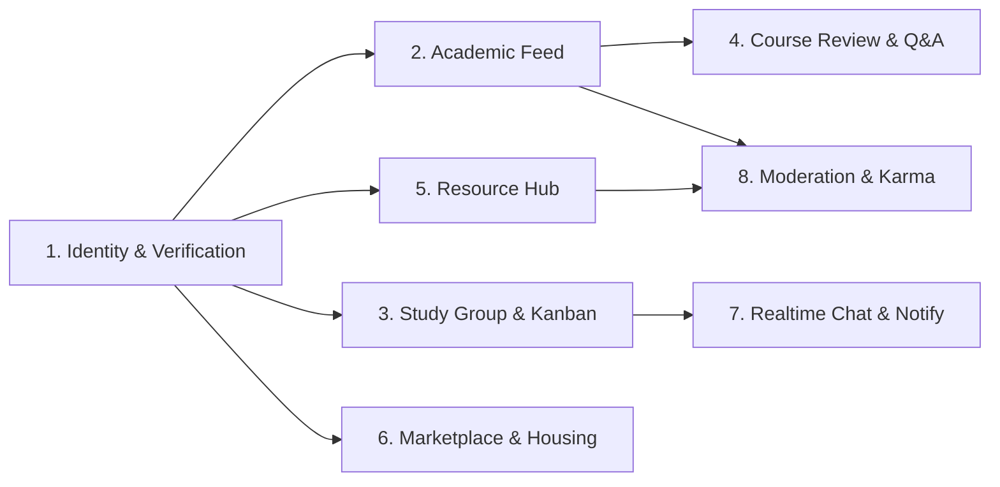

# Tài Liệu Đặc Tả MVP (Minimum Viable Product) — Nền Tảng Mạng Xã Hội Sinh Viên (MXH_HSSV)

> **Tài liệu chuẩn (Single Source of Truth)**: Tài liệu này định nghĩa phạm vi nghiệp vụ MVP, kiến trúc kỹ thuật, mô hình dữ liệu cốt lõi, hợp đồng API và quy tắc nghiệp vụ cho 8 phân hệ của hệ thống `MXH_HSSV`. Mọi `SKILL.md` của từng module đều lấy tài liệu này làm cơ sở triển khai.

---

## 1. Mục tiêu Sản phẩm & Phạm vi MVP

### 1.1. Tầm nhìn sản phẩm
Xây dựng nền tảng mạng xã hội học thuật và đời sống dành riêng cho sinh viên đại học, nơi danh tính sinh viên được xác thực qua email trường (`.edu` / domain trường), kết hợp cơ chế ẩn danh có kiểm soát (`Anonymous Handle`) cho các không gian thảo luận học tập nhạy cảm, tìm nhóm đồ án, đánh giá học phần, chia sẻ tài liệu, chợ sinh viên và giao tiếp thời gian thực.

### 1.2. Kiến trúc Công nghệ Chuẩn hóa (Tech Stack)
- **Backend**: Node.js (LTS) + Express.js + TypeScript
- **ORM & Database**: Prisma ORM + PostgreSQL 16 (sử dụng `tsvector` + `GIN Index` cho Full-Text Search tiếng Việt/Anh, `ltree` hoặc tự tham chiếu cho bình luận đa cấp)
- **Cache & Pub/Sub & Queue**: Redis (lưu trữ OTP có TTL, quản lý phiên Socket, hàng đợi thông báo & tính điểm Karma)
- **Realtime Engine**: Socket.IO (WebSocket cho Chat 1-1, Group Chat đồ án/môn học và Realtime Notifications)
- **File Storage**: S3-compatible Object Storage (MinIO cho môi trường local / AWS S3 hoặc Cloudflare R2 cho production) phục vụ upload PDF, Slide, ảnh đồ cũ
- **Frontend**: React 18 + TypeScript + Vite + TailwindCSS + Zustand (Client State) + TanStack Query (Server State) + React Router v6
- **Trình soạn thảo & Hiển thị học thuật**: TipTap / Markdown Editor + Prism.js/Shiki (Syntax Highlighting) + KaTeX (LaTeX Math) + `react-pdf` (xem trực tiếp PDF)

### 1.3. Quy ước Kiến trúc Xuyên suốt (Cross-Cutting Conventions)
1. **Chuẩn phản hồi API (REST Response Envelope)**:
   ```json
   {
     "success": true,
     "data": {},
     "meta": { "page": 1, "limit": 20, "total": 100 },
     "error": null
   }
   ```
2. **Cơ chế Ẩn danh có Kiểm soát (Controlled Anonymity)**:
   - Mọi bản ghi có hỗ trợ ẩn danh (`posts`, `comments`, `course_reviews`) **luôn lưu `author_id` thật** trong cơ sở dữ liệu để phục vụ kiểm duyệt (Moderation) và tính điểm Karma ngầm.
   - Khi `is_anonymous = true`, tầng Service/Serializer sẽ **ẩn hoàn toàn** `author_id`, `full_name`, `student_id`, `avatar_url` đối với người dùng thông thường và thay bằng `anonymous_handle` + `anonymous_avatar` của sinh viên đó (ngoại trừ Admin/Moderator khi xử lý báo cáo vi phạm).
3. **Phân quyền & Xác thực**:
   - `UNVERIFIED_USER`: Chỉ được xem bảng tin công khai, chưa được đăng bài/tải tài liệu/ứng tuyển nhóm.
   - `VERIFIED_STUDENT`: Đã xác thực OTP qua email `.edu` hoặc SSO trường; mở khóa toàn bộ tính năng sinh viên.
   - `MODERATOR` / `ADMIN`: Quản trị viên duyệt báo cáo vi phạm, cấu hình ngưỡng tự động ẩn bài và quản lý người dùng.

---

## 2. Đặc tả Chi tiết 8 Module Nghiệp vụ trong MVP

---

### Module 1: Identity & Student Verification (Định danh & Xác thực)

#### Phạm vi MVP
- Đăng ký/đăng nhập bằng email trường (kiểm tra whitelist tên miền như `@sis.hust.edu.vn`, `@hust.edu.vn`, `@*.edu.vn`) kết hợp mã OTP 6 chữ số gửi qua email (TTL 5 phút, tối đa 5 lần thử).
- Hỗ trợ luồng đăng nhập SSO OAuth2 (Google Workspace / Microsoft Entra ID của trường).
- Cấp huy hiệu `Verified Student` (`is_verified_student = true`, `verified_at`) ngay sau khi xác thực thành công.
- Quản lý Hồ sơ học thuật (Academic Profile): MSSV (`student_code`), Khóa (`cohort`), Khoa/Viện (`faculty_id`), Chuyên ngành (`major`), Lớp sinh hoạt (`class_name`), Mục tiêu nghề nghiệp (`career_goal`), Kỹ năng kỹ thuật (`tech_skills[]`), Ngoại ngữ (`language_skills[]`).
- Quản lý Định danh ẩn danh (`Anonymous Handle`): Cho phép tạo/đổi biệt danh ẩn danh (có cooldown 30 ngày/lần đổi) để hiển thị trong vùng Hỏi đáp học tập và Review học phần/giảng viên.

#### Bảng dữ liệu chính (`01_identity_verification.sql`)
- `users`: `id`, `email`, `password_hash`, `role`, `is_verified_student`, `verified_at`, `karma_points`, `status`, `created_at`
- `student_verifications`: `id`, `user_id`, `edu_email`, `otp_hash`, `provider` (`EDU_OTP` | `SSO_OAUTH2`), `expires_at`, `attempts`, `verified_at`
- `academic_profiles`: `user_id` (PK/FK), `student_code` (unique), `full_name`, `avatar_url`, `faculty_id`, `major`, `cohort`, `class_name`, `career_goal`, `bio`, `anonymous_handle` (unique), `anonymous_Last_changed_at`
- `user_skills`: `id`, `user_id`, `skill_name`, `category` (`TECHNICAL` | `LANGUAGE` | `SOFT_SKILL`), `proficiency_level`

#### API Trọng tâm
- `POST /api/v1/identity/register-edu` — Đăng ký với email trường & gửi OTP
- `POST /api/v1/identity/verify-otp` — Xác thực OTP & kích hoạt huy hiệu `Verified Student`
- `GET /api/v1/identity/oauth/school` & `GET /api/v1/identity/oauth/school/callback` — SSO OAuth2
- `POST /api/v1/identity/login` / `POST /api/v1/identity/refresh`
- `GET /api/v1/identity/profile/:userId` & `PUT /api/v1/identity/profile`
- `PATCH /api/v1/identity/anonymous-handle` — Cập nhật biệt danh ẩn danh

---

### Module 2: Academic Discussion & Feed (Bảng tin & Thảo luận học thuật)

#### Phạm vi MVP
- **3 luồng bảng tin (Contextual Feeds)**:
  1. `CAMPUS`: Toàn trường (thông báo, sự kiện, đời sống sinh viên).
  2. `DEPARTMENT`: Theo Khoa/Viện (`faculty_id`) để thảo luận chuyên ngành.
  3. `COURSE`: Gắn trực tiếp với mã học phần (`course_id`, ví dụ `IT3080`).
- **Post Engine**:
  - Hỗ trợ Rich Text (Markdown/HTML an toàn đã sanitize XSS), Code Snippet (kèm ngôn ngữ để highlight), công thức toán LaTeX (`$...$` và `$$...$$`), đính kèm tệp (PDF, slide, ảnh).
  - Tự động bóc tách hashtag mã học phần trong nội dung (ví dụ `#IT3080`, `#MI1111`) để gắn liên kết vào bảng `post_course_tags`.
  - Hỗ trợ đăng ẩn danh (`is_anonymous = true`) cho bài đăng loại `QUESTION` hoặc `DISCUSSION`.
- **Engagement & Q&A**:
  - Vote `UPVOTE` (+1), `DOWNVOTE` (-1) và `ENDORSE`/`HELPFUL` trên bài viết & bình luận.
  - Bình luận đa cấp (`parent_comment_id`, độ sâu hiển thị tối đa 3 cấp trên UI).
  - Tác giả bài đăng câu hỏi có quyền đánh dấu 1 bình luận là **Accepted Answer** (`is_accepted_answer = true`), tự động cộng điểm Karma cho người trả lời.

#### Bảng dữ liệu chính (`02_academic_feed_discussion.sql`)
- `faculties`: `id`, `code`, `name`, `description`
- `courses`: `id`, `code` (VD: `IT3080`), `name`, `faculty_id`, `credits`
- `posts`: `id`, `author_id`, `feed_scope` (`CAMPUS` | `DEPARTMENT` | `COURSE`), `faculty_id`, `course_id`, `post_type` (`DISCUSSION` | `QUESTION` | `ANNOUNCEMENT`), `title`, `content_body`, `has_latex`, `has_code`, `is_anonymous`, `upvote_count`, `downvote_count`, `comment_count`, `accepted_comment_id`, `status`, `search_vector`, `created_at`
- `post_attachments`: `id`, `post_id`, `file_url`, `file_name`, `file_type`, `file_size`
- `post_course_tags`: `post_id`, `course_id`
- `comments`: `id`, `post_id`, `author_id`, `parent_comment_id`, `content_body`, `is_anonymous`, `is_accepted`, `upvote_count`, `downvote_count`, `created_at`
- `votes`: `id`, `user_id`, `target_type` (`POST` | `COMMENT`), `target_id`, `vote_type` (`UPVOTE` | `DOWNVOTE` | `HELPFUL`)

#### API Trọng tâm
- `GET /api/v1/feed?scope=CAMPUS|DEPARTMENT|COURSE&facultyId=...&courseCode=...&sort=hot|new|unanswered`
- `POST /api/v1/feed/posts` / `GET /api/v1/feed/posts/:postId` / `PUT /api/v1/feed/posts/:postId` / `DELETE /api/v1/feed/posts/:postId`
- `POST /api/v1/feed/posts/:postId/vote`
- `POST /api/v1/feed/posts/:postId/comments`
- `PATCH /api/v1/feed/posts/:postId/comments/:commentId/accept` — Đánh dấu câu trả lời đúng

---

### Module 3: Study Group & Team Matching (Tìm nhóm & Quản lý đồ án)

#### Phạm vi MVP
- **Teammate Matching**:
  - Đăng tin tuyển thành viên theo mã học phần (`course_id`), học kỳ (`semester`), mục tiêu điểm số (`target_grade`: `A+`, `A`, `B+`, `PASS`), số lượng tối đa và các vị trí cần tuyển (`roles_needed`: `Backend`, `Frontend`, `Embedded`, `AI`, `Leader`, `BA/Tester`...) kèm kỹ năng yêu cầu.
  - Sinh viên ứng tuyển (`group_applications`) vào vị trí cụ thể kèm lời nhắn & link portfolio/CV ngắn gọn.
  - Nhóm trưởng (`LEAD`) duyệt (`APPROVED`) hoặc từ chối (`REJECTED`); khi duyệt tự động thêm vào không gian nhóm kín và phòng chat nhóm.
- **Không gian nhóm kín (Group Workspace)**:
  - Quản lý thành viên theo vai trò (`LEAD`, `MEMBER`).
  - **Mini-Kanban / Task Board**: 4 cột mặc định (`TODO`, `IN_PROGRESS`, `REVIEW`, `DONE`), phân công người phụ trách (`assignee_id`), mức ưu tiên (`LOW`, `MEDIUM`, `HIGH`), hạn chót (`due_date`).
  - **Kho tài liệu chung của nhóm**: Lưu trữ tài liệu nội bộ của đồ án (`group_documents`).

#### Bảng dữ liệu chính (`03_study_group_matching.sql`)
- `study_groups`: `id`, `name`, `course_id`, `semester`, `leader_id`, `target_grade`, `max_members`, `description`, `is_recruiting`, `created_at`
- `recruitment_slots`: `id`, `group_id`, `role_name`, `required_skills`, `quantity_needed`, `quantity_filled`
- `group_applications`: `id`, `group_id`, `slot_id`, `applicant_id`, `cover_note`, `portfolio_url`, `status` (`PENDING` | `APPROVED` | `REJECTED`), `reviewed_at`
- `group_members`: `group_id`, `user_id`, `member_role` (`LEAD` | `MEMBER`), `assigned_position`, `joined_at`
- `kanban_tasks`: `id`, `group_id`, `title`, `description`, `status` (`TODO` | `IN_PROGRESS` | `REVIEW` | `DONE`), `priority`, `assignee_id`, `due_date`, `position_order`, `completed_at`
- `group_documents`: `id`, `group_id`, `uploader_id`, `title`, `file_url`, `file_size`, `created_at`

#### API Trọng tâm
- `GET /api/v1/study-groups/recruitments` & `POST /api/v1/study-groups`
- `POST /api/v1/study-groups/:groupId/apply` & `PATCH /api/v1/study-groups/:groupId/applications/:appId`
- `GET /api/v1/study-groups/:groupId/workspace`
- `GET /api/v1/study-groups/:groupId/tasks` / `POST /api/v1/study-groups/:groupId/tasks` / `PATCH /api/v1/study-groups/:groupId/tasks/:taskId`
- `POST /api/v1/study-groups/:groupId/documents`

---

### Module 4: Course Review & Peer Q&A (Đánh giá học phần & Hỏi đáp)

#### Phạm vi MVP
- **Kho Review học phần & giảng viên**:
  - Đánh giá ẩn danh mặc định (`is_anonymous = true`) cho từng môn học (`course_id`) và giảng viên (`lecturer_id`), mỗi sinh viên chỉ được review 1 lần cho mỗi cặp `(course_id, lecturer_id, semester)`.
  - Chấm điểm theo thang `1–5 sao` trên 4 tiêu chí định lượng:
    1. Độ khó môn học (`difficulty_score`: 1–5)
    2. Khối lượng bài tập / BTL (`workload_score`: 1–5)
    3. Tính công bằng khi chấm điểm (`grading_fairness_score`: 1–5)
    4. Phương pháp giảng dạy & tài liệu cần đọc (`teaching_quality_score`: 1–5)
  - Tự động tính điểm trung bình tổng hợp và phân phối sao cho từng môn học/giảng viên.
- **Diễn đàn hỏi bài theo môn (Subject-specific Forum)**:
  - Tìm kiếm câu hỏi cũ theo mã học phần, thẻ chủ đề hoặc thông báo lỗi (Error message/Stacktrace) nhờ PostgreSQL Full-Text Search (`tsvector`).

#### Bảng dữ liệu chính (`04_course_review_qa.sql`)
- `lecturers`: `id`, `full_name`, `faculty_id`, `email`, `academic_title`
- `course_reviews`: `id`, `course_id`, `lecturer_id`, `author_id`, `semester`, `difficulty_score`, `workload_score`, `grading_fairness_score`, `teaching_quality_score`, `reading_load_score`, `review_content`, `tips_for_junior`, `expected_grade`, `is_anonymous`, `helpful_count`, `status`, `created_at`
- `course_review_aggregates`: `course_id`, `lecturer_id`, `total_reviews`, `avg_difficulty`, `avg_workload`, `avg_fairness`, `avg_teaching`

#### API Trọng tâm
- `GET /api/v1/course-reviews/courses/:courseCode` — Lấy thống kê tiêu chí 1–5 sao & danh sách review
- `POST /api/v1/course-reviews` — Gửi đánh giá học phần & giảng viên (ẩn danh)
- `GET /api/v1/course-reviews/lecturers/:lecturerId`
- `GET /api/v1/course-reviews/forum/search?courseCode=...&q=...` — Full-text search câu hỏi học thuật theo môn

---

### Module 5: Document & Resource Hub (Kho tài liệu mở)

#### Phạm vi MVP
- **Phân tầng tài liệu 4 cấp chuẩn hóa**:
  `Khoa/Viện (Faculty)` -> `Mã môn học (Course)` -> `Kỳ học/Năm (Semester, VD: 2025.1)` -> `Loại tài liệu (Resource Type)`:
  - `MIDTERM_EXAM` (Đề thi giữa kỳ)
  - `FINAL_EXAM` (Đề thi cuối kỳ)
  - `ASSIGNMENT_PROJECT` (Bài tập lớn / Code mẫu)
  - `LECTURE_SLIDE` (Slide bài giảng)
  - `SUMMARY_NOTE` (Tóm tắt lý thuyết / Cheat sheet)
- **Trải nghiệm sử dụng & Đánh giá độ tin cậy**:
  - Xem trước trực tiếp file PDF (`Inline PDF Preview`) trên trình duyệt trước khi tải.
  - Upvote/Downvote độ chính xác & hữu ích của tài liệu (cộng điểm Karma cho người đăng khi nhận Upvote).
  - Kiểm tra trùng lặp bằng mã băm `file_sha256` để tránh upload rác trùng lặp.
  - Báo cáo tài liệu sai kiến thức, vi phạm bản quyền hoặc đề thi cấm tiết lộ.

#### Bảng dữ liệu chính (`05_document_resource_hub.sql`)
- `documents`: `id`, `uploader_id`, `faculty_id`, `course_id`, `semester`, `doc_type` (`MIDTERM_EXAM` | `FINAL_EXAM` | `ASSIGNMENT_PROJECT` | `LECTURE_SLIDE` | `SUMMARY_NOTE`), `title`, `description`, `file_url`, `preview_url`, `file_name`, `file_size`, `file_sha256`, `download_count`, `upvote_count`, `downvote_count`, `status`, `search_vector`, `created_at`
- `document_votes`: `document_id`, `user_id`, `vote_type` (`UPVOTE` | `DOWNVOTE`)
- `document_downloads`: `id`, `document_id`, `user_id`, `downloaded_at`

#### API Trọng tâm
- `GET /api/v1/resources?facultyId=...&courseCode=...&semester=...&docType=...&q=...`
- `POST /api/v1/resources/upload`
- `GET /api/v1/resources/:docId` & `GET /api/v1/resources/:docId/preview`
- `POST /api/v1/resources/:docId/download` (kiểm tra quyền tải theo điểm Karma nếu vượt ngưỡng miễn phí)
- `POST /api/v1/resources/:docId/vote`

---

### Module 6: Campus Marketplace & Housing (Chợ sinh viên & Nhà trọ)

#### Phạm vi MVP
- **Thanh lý đồ dùng học tập (Student Marketplace)**:
  - Đăng tin mua/bán/tặng (`SALE`, `GIVEAWAY`, `WANTED`) cho: Giáo trình cũ (`TEXTBOOK`), Máy tính cầm tay (`CALCULATOR`), Kit vi điều khiển/Linh kiện (`HARDWARE_KIT`), Đồ dùng phòng trọ (`DORM_ITEM`).
  - Bộ lọc theo khoảng giá sinh viên (`price`, `is_free`), tình trạng đồ (`NEW_100`, `LIKE_NEW_90`, `GOOD_80`, `SLIGHTLY_DAMAGED`), mã môn học liên quan (ví dụ giáo trình Giải tích 3, kit STM32 môn Vi xử lý).
- **Tìm bạn ở ghép & Trọ sinh viên (Housing & Roommate Finder)**:
  - Đăng tin tìm phòng trọ hoặc tìm người ở ghép gần khu vực trường (`area_name`, khoảng cách tới trường `distance_km`).
  - Bộ lọc ngân sách tối đa (`max_budget_vnd`) và hồ sơ thói quen sinh hoạt (`sleep_schedule`: `EARLY_BIRD` | `NIGHT_OWL` | `FLEXIBLE`, `smoking`: `boolean`, `cooking_allowed`: `boolean`, `gender_preference`, `cleanliness_level`).

#### Bảng dữ liệu chính (`06_campus_marketplace_housing.sql`)
- `marketplace_items`: `id`, `seller_id`, `category`, `course_id`, `title`, `description`, `price_vnd`, `is_free`, `condition` (`NEW_100` | `LIKE_NEW_90` | `GOOD_80` | `SLIGHTLY_DAMAGED`), `pickup_location`, `status` (`AVAILABLE` | `RESERVED` | `SOLD`), `created_at`
- `marketplace_item_images`: `id`, `item_id`, `image_url`, `display_order`
- `housing_listings`: `id`, `poster_id`, `listing_type` (`ROOM_FOR_RENT` | `ROOMMATE_WANTED`), `title`, `address_area`, `distance_to_campus_km`, `monthly_rent_vnd`, `max_budget_vnd`, `electricity_water_note`, `sleep_schedule`, `smoking_allowed`, `cooking_allowed`, `gender_preference`, `status` (`OPEN` | `CLOSED`), `created_at`

#### API Trọng tâm
- `GET /api/v1/marketplace/items` & `POST /api/v1/marketplace/items` & `PATCH /api/v1/marketplace/items/:itemId/status`
- `GET /api/v1/marketplace/housing` & `POST /api/v1/marketplace/housing` & `PATCH /api/v1/marketplace/housing/:housingId/status`

---

### Module 7: Realtime Communication (Giao tiếp thời gian thực)

#### Phạm vi MVP
- **Direct Messaging (1-1)**: Nhắn tin trực tiếp giữa các sinh viên (ví dụ trao đổi mua giáo trình, hỏi bài riêng, trao đổi ở ghép).
- **Group Chat học phần / nhóm đồ án**: Mỗi `study_group` khi khởi tạo sẽ tự động có 1 phòng chat nhóm riêng (`conversation_type = 'PROJECT_GROUP'`), hỗ trợ gửi tin nhắn văn bản, snippet code và đính kèm file tài liệu trực tiếp.
- **Realtime Notifications**:
  - Đẩy thông báo tức thời qua Socket.IO (`notification:new`) kết hợp lưu DB khi:
    - Bài đăng có bình luận mới hoặc câu trả lời được đánh dấu `Accepted Answer`.
    - Có ứng viên nộp đơn vào nhóm đồ án hoặc đơn ứng tuyển được duyệt.
    - Nhắc hạn nộp task trên Mini-Kanban (`TASK_DEADLINE_SOON`).

#### Bảng dữ liệu chính (`07_realtime_communication.sql`)
- `conversations`: `id`, `type` (`DIRECT` | `PROJECT_GROUP` | `COURSE_CHANNEL`), `study_group_id`, `course_id`, `title`, `last_message_at`, `created_at`
- `conversation_participants`: `conversation_id`, `user_id`, `last_read_message_id`, `joined_at`, `is_muted`
- `messages`: `id`, `conversation_id`, `sender_id`, `content`, `attachment_url`, `attachment_name`, `message_type` (`TEXT` | `FILE` | `SYSTEM`), `created_at`
- `notifications`: `id`, `recipient_id`, `actor_id`, `type` (`POST_REPLY` | `ANSWER_ACCEPTED` | `GROUP_INVITE` | `APPLICATION_STATUS` | `TASK_DEADLINE` | `KARMA_REWARD`), `title`, `body`, `reference_type`, `reference_id`, `is_read`, `created_at`

#### API & Socket Events Trọng tâm
- **REST**:
  - `GET /api/v1/communication/conversations` & `POST /api/v1/communication/conversations/direct`
  - `GET /api/v1/communication/conversations/:convId/messages`
  - `GET /api/v1/communication/notifications` & `PATCH /api/v1/communication/notifications/read-all`
- **Socket.IO Events**:
  - Client -> Server: `chat:join`, `chat:send_message`, `chat:typing`, `chat:mark_read`
  - Server -> Client: `chat:new_message`, `chat:user_typing`, `notification:new`

---

### Module 8: Moderation & Reputation System (Kiểm duyệt & Điểm uy tín)

#### Phạm vi MVP
- **Hệ thống điểm uy tín (Academic Karma / Contribution Points)**:
  - Bảng quy tắc cộng/trừ điểm minh bạch (ghi sổ cái bất biến `karma_ledger`):
    - Tài liệu upload được duyệt / nhận Upvote: `+5 Karma`
    - Câu trả lời được đánh dấu `Accepted Answer`: `+15 Karma`
    - Bài viết/Bình luận nhận Upvote hoặc Helpful: `+2 Karma`
    - Hoàn thành đúng hạn Task trong nhóm đồ án: `+5 Karma`
    - Bài đăng/Tài liệu bị xóa do vi phạm kiểm duyệt: `-20 Karma`
  - **Mở khóa đặc quyền (Privileges)**:
    - `< 0 Karma`: Giới hạn đăng bài, cần chờ duyệt.
    - `>= 0 Karma (Mặc định Verified Student)`: Tải tối đa 10 tài liệu/ngày.
    - `>= 50 Karma (Active Contributor)`: Tải tài liệu không giới hạn.
    - `>= 150 Karma (Trusted Scholar)`: Tạo không gian thảo luận chuyên đề riêng, gắn nhãn `Trusted Contributor`.
- **Kiểm duyệt nội dung (Moderation Engine)**:
  - Người dùng báo cáo vi phạm (`reports`) trên bất kỳ thực thể nào (`POST`, `COMMENT`, `DOCUMENT`, `COURSE_REVIEW`, `MARKETPLACE_ITEM`, `HOUSING_LISTING`) theo lý do: `LEAKED_EXAM` (Đề thi cấm leak), `SCAM_HOUSING` (Lừa đảo trọ/mua bán), `HARASSMENT_TOXIC` (Ngôn từ tiêu cực/công kích), `COPYRIGHT_WRONG_DOC` (Tài liệu sai/vi phạm bản quyền), `SPAM`.
  - **Cơ chế tự động (Auto-Moderation)**: Khi một nội dung chạm ngưỡng báo cáo độc lập từ các sinh viên đã xác thực (ví dụ `>= 5 reports`), hệ thống tự động chuyển trạng thái sang `HIDDEN_PENDING_REVIEW` để ẩn khỏi bảng tin ngay lập tức.
  - **Admin/Mod Dashboard**: Xem hàng đợi báo cáo, xem danh tính gốc của bài ẩn danh vi phạm, thực thi quyết định (`DISMISS_REPORT`, `REMOVE_CONTENT`, `WARN_USER`, `SUSPEND_USER`).

#### Bảng dữ liệu chính (`08_moderation_reputation.sql`)
- `karma_ledger`: `id`, `user_id`, `action_type`, `points_delta`, `reference_type`, `reference_id`, `created_at`
- `privilege_tiers`: `id`, `tier_code`, `min_karma`, `daily_download_limit`, `can_create_custom_group`, `badge_label`
- `content_reports`: `id`, `reporter_id`, `target_type`, `target_id`, `reason_code` (`LEAKED_EXAM` | `SCAM_HOUSING` | `HARASSMENT_TOXIC` | `COPYRIGHT_WRONG_DOC` | `SPAM`), `description`, `status` (`PENDING` | `RESOLVED_REMOVED` | `RESOLVED_DISMISSED`), `reviewed_by`, `reviewed_at`, `created_at`
- `moderation_actions`: `id`, `moderator_id`, `target_user_id`, `target_type`, `target_id`, `action_taken` (`AUTO_HIDE` | `DELETE_CONTENT` | `WARN` | `TEMPORARY_BAN` | `PERMANENT_BAN`), `reason`, `expires_at`, `created_at`

#### API Trọng tâm
- `GET /api/v1/moderation/karma/me` & `GET /api/v1/moderation/karma/leaderboard`
- `POST /api/v1/moderation/reports` — Gửi báo cáo vi phạm
- `GET /api/v1/moderation/admin/queue` — Hàng đợi kiểm duyệt cho Mod/Admin
- `POST /api/v1/moderation/admin/actions` — Duyệt báo cáo, xóa bài, khóa tài khoản

---

## 3. Lộ trình Triển khai MVP (Implementation Order)

Để đảm bảo tính phụ thuộc dữ liệu (Foreign Keys & Shared Services), các module được triển khai theo thứ tự chuẩn:



1. **Giai đoạn 1 (Nền tảng & Định danh)**: Khởi tạo Database (`faculties`, `courses`, `users`, `academic_profiles`) + Module 1 (`identity`).
2. **Giai đoạn 2 (Học thuật cốt lõi)**: Module 2 (`feed`), Module 4 (`course-review`), Module 5 (`resource-hub`).
3. **Giai đoạn 3 (Cộng tác & Đời sống)**: Module 3 (`study-group`), Module 6 (`marketplace`), Module 7 (`communication`).
4. **Giai đoạn 4 (An toàn & Điểm uy tín)**: Module 8 (`moderation` & `academic-karma`).
